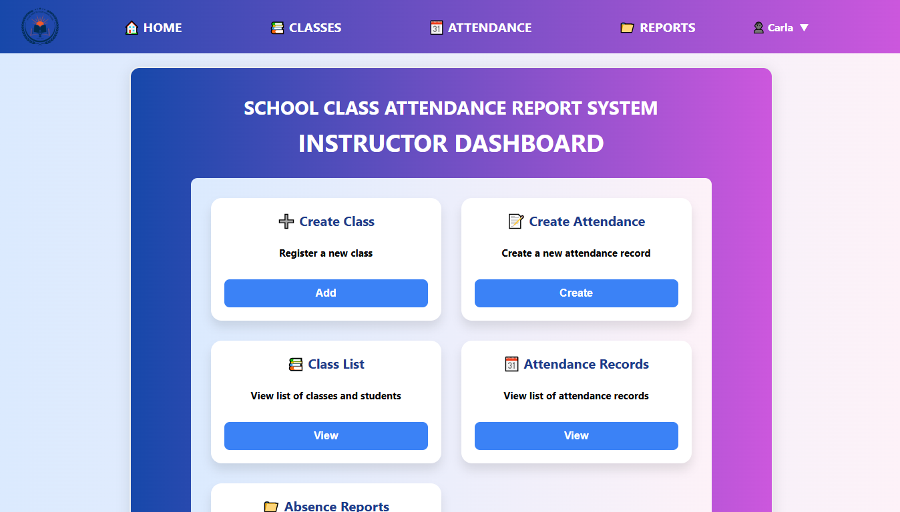
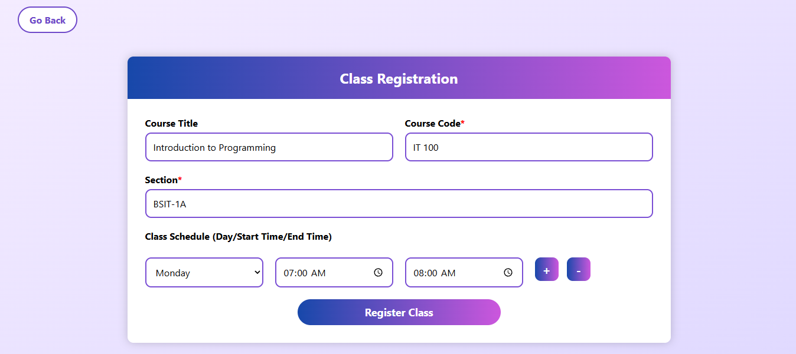
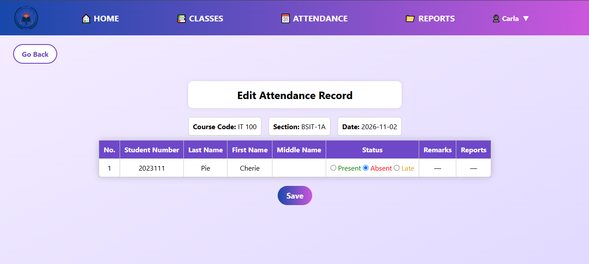
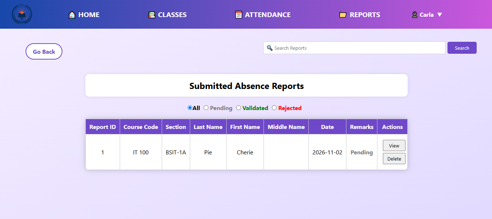

# ClassTrack: Class Attendance and Absence Report System

ClassTrack is a class attendance system designed for college instructors and students. It lets instructors create and mark daily attendance records, and students submit absence reports with proof through document uploads. 



## 1. Project Status
- This was my first CRUD project and records the mistakes I made as an early developer. I observed structural and logical flaws in the system design and factoring. As a testament to how much I've grown over the years, I've decided to rebuild the project with a framework and modern tech stack.
- This rebuild aims to practice my skills with my target standardized tech stack and workflows. Additionally, it gives me an opportunity to observe and report improvements in engineering practices and the application's performance, efficiency, and security between the legacy and modernized project.
- **Key Goals:** FastAPI backend framework, React frontend framework, PostgreSQL database migration, Docker containerization, and configuration for cloud deployment (Azure/AWS/GCP)

## 2. Key Features

#### 2.1. Class Registration

- **Instructors:** Create class records for sections and assign their courses and class schedules.
- **Students:** Select and enroll in existing sections and courses.



#### 2.2. Attendance Records

- **Instructors:** Create attendance records and mark students as present, absent, or late. The Remarks and Reports columns update when a student submits an absence report.
- **Students:** View their attendance records.



#### 2.3. Absence Reports

- **Instructors:** View submitted absence reports by students. Teachers can validate or reject their reports. While unmarked, its status is 'Pending.'
- **Students:** If a student is marked absent, they can submit an absence report and provide the date, description, and upload documents and images to support the reasoning for their absence.



## 3. Tech Stack

**Note:** This project is undergoing active rewrite. The original PHP application lives in the `legacy/` directory and is being ported to a modernized stack. Both legacy and modernized versions of the application can run during the transition period.

| Layer | Current (legacy) | Target (new) |
|---|---|---|
| Backend | PHP | Python FastAPI |
| Database | MySQL | PostgreSQL |
| Frontend | HTML, CSS, Vanilla JavaScript | React & TypeScript |
| Build | — | Vite |
| Containerization | — | Docker |

## 4. Project Structure

```
classtrack/
├── legacy/              # Original PHP code - for reference only, do not add features
├── backend/             # FastAPI + SQLAlchemy
│   ├── app/
│   ├── requirements.txt
│   └── Dockerfile
├── frontend/            # React + TypeScript + Vite
│   ├── vite.config.ts   # api:8000
│   ├── package.json
│   └── Dockerfile
├── docker-compose.yml   # services for web, db, postgres, api, frontend
```

### `legacy/` folder

`legacy/` contains the the original PHP application. It runs through the `web` + `db` services on docker-compose.yml.
- ✅ **You can:** Use this folder to understand business rules and internal queries and port pages.
- ❌ **Do not:** Add new features / non-functional files that didn't exist prior or change the database schema and dependencies.

### `mysql` vs `postgresql` database

In docker-compose.yml:
- `db` — contains the MySQL schema for the files in the `legacy/` schema. *DO NOT* write to the MySQL db and *DO NOT * delete the db to ensure it still boots .
- `postgres` — this is the new database schema shall use PostgreSQL. All new development must target this i.e. via Alembic migration.

## 5. Installation

### 5.1. Prerequisites

- **Docker Desktop** (Windows/macOS) or **Docker Engine + Compose plugin** (Linux)
- **Git**

### 5.2. Setup

```bash
git clone <repo-url> classtrack
cd classtrack

cp .env.example .env
cp backend/.env.example backend/.env
docker compose up -d --build
```

- Check all services are up:

```bash
docker compose ps
```

| Service | URL |
|---|---|
| `frontend` (React) | http://localhost:5173 |
| `api` (FastAPI) | http://localhost:8000 — docs at `/docs` |
| `web` (legacy PHP) | http://localhost:8080 |
| `postgres` | localhost:5432 |
| `db` (legacy MySQL) | localhost:3306 |

- Run migrations once `api` is up:

```bash
docker compose exec api alembic upgrade head
```

- Build the app:

```bash
docker compose up -d --build api frontend
```

### 5.3. Common Errors

- **Port conflicts:** if 5432 is taken (local Postgres), stop it or change `"5432:5432"` to `"5433:5432"` in `docker-compose.yml`. Same for 3306.
- **Hot reload is on:** edit `backend/app/` or `frontend/src/`, changes apply within a second. Rebuild only when `requirements.txt` or `package.json` changes.

### 5.4 Notes for Maintainers

- The `web` (PHP) and `db` (MySQL) services are temporary. Once the new backend and frontend reach feature parity, both services and `legacy/` will be deleted.
- CI should build the `api` and `frontend` images and run lint + tests on every PR.
- Keep `.env.example` in sync with any new required variable — a contributor's first `docker compose up` should never fail because of a missing key.
- **Line endings:** ensure `.gitattributes` pins `*.sh`, `Dockerfile`, and `docker-compose.yml` to LF, otherwise Windows contributors using autocrlf will produce files that fail to run in Linux containers.
